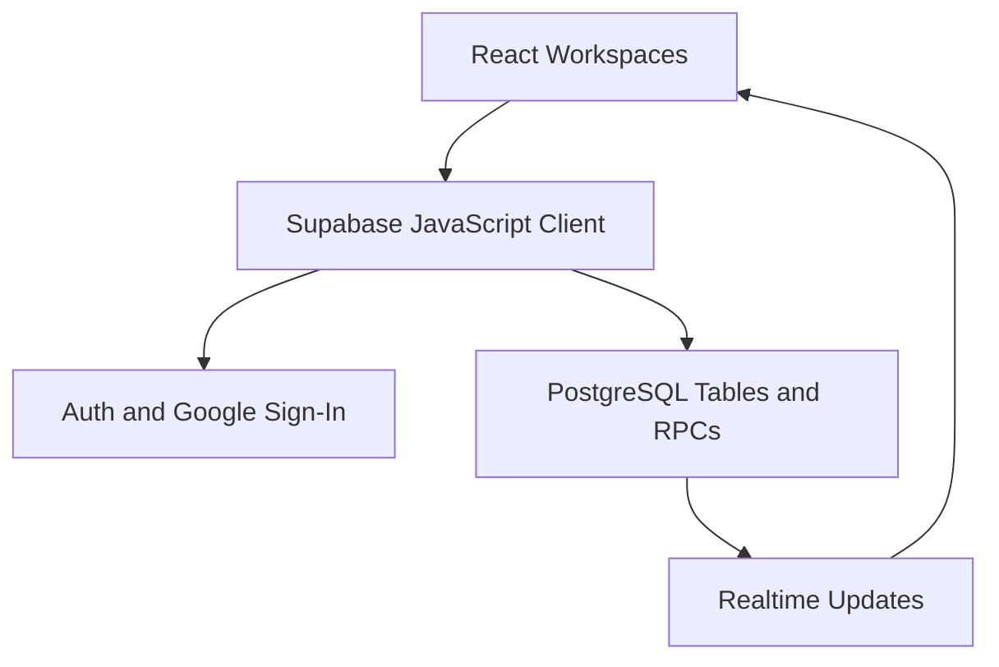

# LifeCity Attendance

**A welcoming check-in experience. A dependable record of every gathering.**

LifeCity Attendance is a QR-based church attendance web application for **LifeCity Church of Christ**. It brings member registration, personal QR codes, service management, camera check-in, attendance reporting, and account administration into one workspace.

Members get a personal space for their profile, QR, attendance history, and feedback tickets. Guests can explore public gatherings without an account. Administrators manage day-to-day registration and check-in, while the Owner handles account access, identity-link reviews, shared appearance, activity history, and submitted feedback.

[Live Web App](https://lifecity-attendance.vercel.app/) · [Source Repository](https://github.com/gbppimentel-dev/lifecity-attendance) · [Backend Contract](docs/backend-contract.md)

> **Project stage:** the web experience has completed its current polish phase. Mobile polishing is next. The repository package version remains `0.1.0`; the in-app changelog describes development milestones rather than claiming a released v1.0.
>
> **New installation note:** this repository contains the current frontend and limited database SQL, including targeted updates. The deployed application requires additional tables, functions, policies, and triggers that are not yet tracked here. Running `supabase/schema.sql` alone will **not** provision the full current app. See [Backend Setup](#backend-setup) before attempting a fresh installation.

## Contents

- [What the App Does](#what-the-app-does)
- [Workspaces and Access](#workspaces-and-access)
- [Typical Workflows](#typical-workflows)
- [Architecture](#architecture)
- [Technology Stack](#technology-stack)
- [Local Development](#local-development)
- [Portfolio Demo](#portfolio-demo)
- [Backend Setup](#backend-setup)
- [Data, QR Codes, and Privacy](#data-qr-codes-and-privacy)
- [CSV Imports and Exports](#csv-imports-and-exports)
- [Appearance and Motion](#appearance-and-motion)
- [Project Structure](#project-structure)
- [Deployment](#deployment)
- [Validation and Troubleshooting](#validation-and-troubleshooting)
- [Maintaining the Project](#maintaining-the-project)
- [Current Limits and Next Phase](#current-limits-and-next-phase)
- [Credits and License](#credits-and-license)

## What the App Does

### Member Directory

- Register and edit member profiles with names, contact details, active/inactive status, and private administrative notes.
- Use a grouped member form with searchable church/ministry choices, selected counts and optional inline creation. Matched desktop rows pair contact details with the private reminder, then Churches with Ministries. Fields start directly with First Name and Last Name; headings and controls use Title Case.
- Associate members with multiple churches and ministries.
- Search, filter, sort, and paginate the directory.
- Scan compact identity/community rows with inline Star/Unstar, existing private notes and QR/ID access. Open a name for its profile, or use the remaining profile/edit actions in the member tools menu. A circular checkbox uses teal for active and rose for inactive, with a white check/X disk and accessible status labels. Its interaction is adapted from Javierrocadev on Uiverse.io.
- Status changes require a confirmed database response and provide 10-second Undo while the directory remains open. Later status changes, profile editing and bulk status actions supersede earlier status Undo. Failed or uncertain writes refresh the directory and clear cached counts.
- Choose among four sort options directly, review removable filter chips, and clear the current filters without cycling through sort modes.
- Star members and use the supported bulk actions to manage selections.
- View member profiles in a side panel with Overview and Attendance tabs. Private notes open in a matching panel and can be edited there; note-only saves verify the returned row and refuse to overwrite a note changed elsewhere. A focused member ID dialog presents the private QR code and download action.
- Download QR images and generated member IDs.
- Import CSV data with mapping, validation, preview, and review before submission.
- Export a quick directory or a detailed administrative CSV.
- Use a solid teal Add Member action and distinct Import, Ministry and Church tool icons, with subtle lift, icon scaling and press feedback that respect motion preferences. Directory Tools uses a compact hanging label with matching attached Download Template/Close controls; ministry and church panels use the same close tab.
- Opening a directory tools panel scrolls to keep its three switching buttons just below the header. Ministry and church feedback uses the same anchor for validation, saved changes, deletion and Undo, leaving an already-visible toolbar steady. Inline editors and confirmations focus without scrolling; late feedback cannot pull a closed panel into view. CSV export uses a compact utility panel that shows its matching-member scope and retains all-page filtering and sort behavior.
- Add ministries/churches inline; swipe a category row or use its action control for Rename and Delete. Rename has labeled, aligned Save/Cancel controls, and deletion names the entry with explicit Keep/Delete choices. Themed inline notices explain success, blocked changes and errors, with affected-member shortcuts where relevant.
- Successful category deletion offers a 10-second Undo toast, paused on hover/focus. Undo restores the actual deleted row, including its original ID, name and returned columns, and never overwrites a conflicting record. Ministry deletion first requires the [one-time database update](#one-time-directory-delete-setup).
### Services and Gatherings

- Create and edit services with a name, start date/time, venue, Sunday-service flag, public visibility, and administrative note.
- Distinguish upcoming, in-progress, completed, and archived services.
- Archive or restore services through the available action flow.
- Delete services only when the applicable data rules allow it.
- Search, filter, sort, paginate, and export service data.
- Mark Sunday directly on a service row. Swipe or use its actions button for Edit and Delete/Archive/Restore. A shared Check-In Desk opens the scanner for an eligible service; the desktop Date/Service header includes a quiet swipe instruction on its right.
- Schedule services with a custom calendar and time picker. New minute choices are 00, 15, 30 and 45; existing off-quarter times remain unchanged until explicitly edited. Calendar navigation, focus restoration and required-field validation are supported.
- Inline changes keep the current service rows visible while the same view refreshes. Failed background reads retain the last loaded list with an inline retry message.
- Keep service details visible in the closed row; expand administrative notes on phones. Swiping only reveals controls, and destructive actions retain their confirmation flow.
- Hold the final delete button for 1.3 seconds to confirm; releasing early cancels. Sunday marking, archive, restore and deletion show an Undo toast for 10 seconds, paused on hover/focus. Delete Undo restores the original service ID and saved columns; attendance protection still applies.
- Notifications are held in the current browser session. Reloading or signing out clears them. A newer change to the same service field replaces its earlier Undo, and Undo refuses a conflicting current value.
- Show eligible public services to guests and members.

### QR Check-In and Kiosk

- Select a service and scan member QR codes with the device camera.
- Display successful, duplicate, and unsuccessful check-in feedback.
- See the selected service's total in the page header. Confirmed new attendance refreshes that total from the server; duplicate and unsuccessful check-ins do not increment it.
- Choose ongoing or upcoming gatherings from a searchable side panel with a fixed search field and grouped calendar rows.
- Before selecting a service, use quick cards for the ongoing and next upcoming services. Cards show their schedule, venue and check-in count.
- Search for a member and check in manually when a QR code cannot be scanned.
- Review a matched member before confirming manual attendance. Search errors, no matches, inactive members and duplicate check-ins have distinct feedback; a short cooldown prevents a held QR from being submitted repeatedly.
- Retry camera startup and switch available cameras.
- Switch cameras using the camera-switch icon.
- Use a fixed, non-scrolling kiosk layout. The camera has priority; service details, attendance total, latest result and Exit Kiosk remain visible. Manual entry is available after exiting kiosk.
- The camera preview fills its panel without a square scan mask. The video retains its native aspect ratio, and the decoder scans the whole source frame.
- A corner guide marks QR placement in web and kiosk views. The surrounding preview is dimmed to highlight the clear target; this visual overlay does not restrict the decoder's scanning area.
- Keep member details out of the QR payload: the app uses an opaque token.
- Refresh relevant attendance totals through subscriptions and other component refresh behavior.

Camera, fullscreen, audio, and camera-switching support depend on the browser and hardware. Kiosk presentation is not an operating-system lockdown feature.

### Dashboard and Attendance Records

- View a dashboard snapshot, attendance totals, and recent check-in activity.
- Choose the Dashboard period through a themed GlideSelect menu. The previous snapshot stays visible while the refresh control shows loading; CountUp retargets the four primary metrics from their current display when the response arrives. Mobile retains its compact update status.
- Open historical records with service and member filters.
- Narrow reports by church, ministry, Sunday-service selection, date range, and report scope.
- Default Records to completed services; explicitly choose in-progress or archive-inclusive scopes when needed.
- Exclude upcoming services from reportable attendance history.
- Inspect saved member/service snapshot information and provenance.
- Use grouped community/service rows, direct column sort choices and a focused attendance details side panel. Desktop headers offer category-specific sort menus with one active order; narrow screens keep the compact overall sort menu. Aligned filters and distinct colored totals make the current view easier to scan. Same-view refreshes retain the existing rows.
- Hold Remove for 1.3 seconds to confirm a check-in removal. Confirmed removals offer a 10-second Undo toast, paused on hover/focus; restoration preserves the original ID, time, scanner, note and reporting snapshot. This requires the [one-time Records update](#one-time-attendance-undo-setup).
- Export matching records across pages using Quick or Detailed CSV.

The service directory export and attendance report export serve different purposes: one describes services as they currently exist; the other reports recorded attendance with saved historical details.

### Personal Member Space

- See current and upcoming services near the top, with a three-service preview and an expandable paginated schedule.
- View the linked directory profile and personal attendance QR.
- Open the attendance QR in a native side panel. QR and Member ID downloads recheck the active member connection before exporting; profile/token/status changes or failed access checks close the private panel.
- Review searchable attendance history with date filters, saved service details and compact report totals.
- Browse upcoming/current gatherings.
- Update a mobile number directly through the supported profile flow.
- Edit contact information and submit other profile changes for Owner review in a side panel with separate Profile Details and Requests tabs.
- Review compact before/requested comparisons and previous decisions without stretching the adjacent QR card.
- Follow personal feedback tickets, see unread updates, mark updates as read, and open the guarded feedback composer directly from the ticket section.

Signing in does not automatically connect a Google account to a member record. Unlinked users submit a link request so the Owner can verify the connection.

### Owner Workspace

- Search and review accounts, roles, access status, and member links.
- Grant or remove administrator access, suspend/reactivate accounts, and manage profile connections.
- Review member-link and profile-change requests with confirmation steps.
- Use aligned request filters and compact current/requested comparisons. Leaving the Accounts tab clears transient confirmations and member verification while keeping searches and filters.
- Inspect activity history and use its export flow.
- Edit shared appearance settings with a custom color picker and live preview.
- Keep unsaved palette choices when switching Settings tabs; save, discard or reload explicitly. Palette edits stay within the preview until saved.
- Review feedback, reveal a masked sender when needed, and update ticket status.
- Sender reveals clear when leaving Feedback or hiding the browser tab. Same-filter account, request, activity and feedback refreshes retain their last successful content while loading.

### Feedback and Release History

- Open a compact feedback launcher from the shared application footer area.
- Submit a bug report, feature idea, improvement, or other app feedback while signed in.
- Choose to hide identity by default in the Owner inbox.
- Track tickets as **New**, **In Progress**, **Completed**, or **Considered**.
- See role-specific What’s New entries and Version History.
- Open the Tech Stack page from the footer and select a technology to learn how the app uses it.

Guest Preview presents a public service schedule with calendar cards, current/upcoming status, Manila times and venues. Member and guest service cards use paper-style status and Sunday labels overlapping the top-right corner, with restrained hover motion. Same-page refreshes retain the last matching schedule; changing pages uses a loading state until the requested page arrives. The UI projects the guest RPC response to public fields only, without member data, attendance counts or private notes.

“Completed” means an improvement has been implemented. “Considered” keeps an idea available for possible future work. Internally, existing backend values `resolved` and `closed` remain mapped to those visible labels for compatibility.

## Workspaces and Access

| Capability | Guest | Signed-In Member / User | Administrator | Owner |
| --- | --- | --- | --- | --- |
| Browse public gatherings | Yes | Yes | Yes | Yes |
| View own linked profile and QR | No | When linked | When linked | When linked |
| Submit app feedback | No | Yes, with active access | Yes, with active access | Yes, with active access |
| Track own feedback tickets | No | Member space | Member space when linked | Member space when linked |
| Manage directory and services | No | No | Yes | Yes |
| Scan and review attendance reports | No | No | Yes | Yes |
| Review member-link/profile requests | No | No | No | Yes |
| Manage accounts and shared appearance | No | No | No | Yes |
| Inspect Owner feedback inbox/activity | No | No | No | Yes |

This table summarizes frontend workspaces. Deployed database policies and RPC authorization must enforce the same boundaries. Hiding a control in React is not an authorization boundary. Account status can also restrict access independently of role.

## Typical Workflows

### Register → Connect → Check In

1. An administrator registers a member or imports reviewed directory data.
2. The member receives a QR code or member ID.
3. The member signs in with Google and, if necessary, submits a link request.
4. The Owner verifies the requested identity and connects the account to the directory profile.
5. An administrator chooses the appropriate service and scans the member QR.
6. The app records attendance or reports an existing check-in.
7. Staff review attendance in Records and export the desired report.

### Correct a Profile

1. A linked member opens **Edit Profile & Requests**.
2. Mobile changes use the direct-save confirmation flow.
3. Other profile fields are submitted as a review request.
4. The Owner compares existing and requested values and approves or declines.
5. The member can read the outcome and any accompanying review note.

### Turn Feedback Into an Update

1. A signed-in user submits feedback about LifeCity Attendance.
2. The Owner reviews it and updates its status.
3. The sender sees unread ticket updates in their member space.
4. Implemented changes are marked Completed; deferred ideas can remain Considered.
5. Maintainers add shipped improvements to `src/lib/releaseNotes.ts`, assigning the correct audiences to each highlight.

## Architecture



The frontend is a TypeScript React single-page application bundled by Vite. `App.tsx` resolves authentication/account state and selects the appropriate workspace. Staff navigation uses component state rather than a routing library. Larger screens are loaded lazily; `ScreenBoundary` supplies loading/error containment.

Staff navigation warms a destination module on pointer or keyboard-focus intent. After the first screen paints, idle work warms Members, Records and Owner Settings sequentially; this background queue skips Data Saver and reported 2g connections. Scanner loads on navigation intent rather than in that queue. Navigation selects the destination immediately and keeps the current view visible while its module loads, with a progress indicator and guards against late commits from superseded navigation.

Supabase provides authentication, database queries, RPC access, and Realtime subscriptions. Components use hooks to load data, debounce searches, coordinate mutations, and refresh results. There is no separate custom Node/Express backend in this repository.

Visited Dashboard, Records and Owner Settings screens remain mounted in native hidden panels. Settings retains visited tabs, including filters and palette drafts; hidden panels cannot receive keyboard focus. Visible panels enter with a short opacity fade that respects motion preferences. Members keeps its existing remount cleanup and recent query snapshots; Services retains its list while background data arrives. Scanner unmounts when leaving so camera tracks stop. Confirmed attendance changes and Realtime events revalidate retained Records in place.

An in-memory cache belongs to each signed-in staff workspace, with at most 12 snapshots expiring after 60 seconds. Dashboard and the Members default first-page query can initialize from a recent snapshot. Refresh controls, mutations and Realtime subscriptions still retrieve current data. Cache entries are not written to disk and disappear when that workspace unmounts, including on sign-out.

The interface uses custom CSS, theme variables, SVG illustrations, Lucide icons and native browser dialogs. AnimatedContent supplies GSAP section fades; its reusable API also supports ScrollTrigger. Motion and browser animation APIs support local interactions. The Tech Stack view is a full-screen native dialog with bundled technology logos: closing it restores the preceding screen instead of discarding its state.

## Technology Stack

### Direct Packages

Versions below are declared ranges from `package.json`; `package-lock.json` is authoritative for exact installed versions.

| Package | Declared Version | Actual Role |
| --- | --- | --- |
| `react` | `^19.1.1` | Components, hooks, state, lazy loading |
| `react-dom` | `^19.1.1` | DOM rendering and portals |
| `@supabase/supabase-js` | `^2.57.4` | Authentication, queries, RPCs, Realtime |
| `html5-qrcode` | `^2.3.8` | Camera QR decoding |
| `qrcode.react` | `^4.2.0` | SVG QR generation |
| `papaparse` | `^5.5.3` | CSV import parsing |
| `lucide-react` | `^0.544.0` | Interface icons |
| `@fontsource-variable/inter` | `^5.3.0` | Self-hosted variable Inter typography |
| `motion` | `^14.7.1` | Drag tracking and spring transitions for Services swipe actions |
| `gsap` | `^3.15.0` | AnimatedContent fades and optional ScrollTrigger entrances |
| `@vitejs/plugin-react` | `^5.0.2` | React integration for Vite; build tooling even though listed under dependencies |
| `typescript` | `~5.9.2` | Strict type checking |
| `vite` | `^7.1.3` | Development server and production bundling |
| `@types/react` | `^19.1.12` | React type definitions |
| `@types/react-dom` | `^19.1.9` | React DOM type definitions |
| `@types/papaparse` | `^5.5.2` | Papa Parse type definitions |

### Platform Technologies and Services

| Area | Technologies and Use |
| --- | --- |
| Markup and styles | HTML, custom CSS, CSS variables, gradients, media queries, keyframes |
| Language output | TypeScript/TSX compiled into JavaScript; ES modules |
| Data | PostgreSQL, SQL functions/RPCs, Row Level Security, UUIDs, initial-schema `pgcrypto` extension |
| Identity | Supabase Auth and Google OAuth |
| Live updates | Supabase Realtime database-change subscriptions |
| Camera and kiosk | Browser media APIs, video tracks/capabilities, Fullscreen API |
| Sound | Web Audio API scanner feedback |
| Images and downloads | SVG, Canvas 2D, Blob, object URLs, file inputs, browser download links |
| Time | JavaScript Date and Intl formatting, including `Asia/Manila` |
| Interaction | Native dialogs, GSAP/ScrollTrigger, Web Animations API, IntersectionObserver, ResizeObserver, DOM events |
| Preferences and request IDs | Local Storage and Web Crypto UUID generation |
| Web identity | Web App Manifest, favicon, Apple touch icon, standalone-display metadata |
| Development | Node.js, npm, Git, GitHub |
| Hosting | Vercel for the deployed web app; hosting configuration is external to this repository |

The app bundles variable Inter with the normal and italic Latin font files through Fontsource. Fonts load from the app itself with system fallbacks while loading; there is no external font request at runtime.

The current project does **not** declare React Router, Tailwind, Bootstrap, Radix, TanStack Query, Workbox, or Capacitor. They should not be added to the inventory merely because another app uses them. Vite's transitive build dependencies remain recorded in the lockfile rather than being presented as separately designed app features.

## Local Development

### Requirements

- Git and npm.
- A Node.js version satisfying the locked Vite engine requirement: `^20.19.0 || >=22.12.0`.
- A compatible Supabase backend with the complete deployed application contract.
- A modern browser. Camera testing requires localhost or an HTTPS origin.

### Install and Run

```bash
git clone https://github.com/gbppimentel-dev/lifecity-attendance.git
cd lifecity-attendance
npm ci
```

Create `.env.local` in the project root:

```dotenv
VITE_SUPABASE_URL=https://YOUR_PROJECT.supabase.co
VITE_SUPABASE_PUBLISHABLE_KEY=YOUR_BROWSER_PUBLISHABLE_KEY
```

These are the **exact names** read by `src/lib/supabase.ts`. An environment variable named `VITE_SUPABASE_ANON_KEY` will not be read by this code unless the code is changed. Use the browser-safe key supplied for the project; never insert a service-role key, database password, or OAuth client secret into a `VITE_` variable.

```bash
npm run dev
```

Open the address printed by Vite, usually `http://localhost:5173`. Restart the development server after changing environment variables.

### Available Commands

| Command | Purpose |
| --- | --- |
| `npm ci` | Install exact dependencies from the lockfile |
| `npm run dev` | Start Vite development server |
| `npm run build` | Run `tsc -b`, then create the production bundle |
| `npm run preview` | Serve the built bundle locally for inspection |
| `npm run demo:generate` | Generate fictional presentation data |
| `npm run demo:sql` | Build the demo reset SQL files |
| `npm run test:demo` | Check generated demo data |
| `npm run test:demo:sql` | Check the demo reset SQL |
| `npm run test:services` | Check service action behavior |
| `npm run test:directory` | Check ministry/church deletion, Undo and the ministry SQL guard |
| `npm run test:member-status` | Check confirmed member status updates and Undo |
| `npm run test:member-notes` | Check note-only saves, stale-note protection and errors |
| `npm run test:schedule` | Check calendar boundaries, Manila dates, quarter-hour choices and legacy time preservation |
| `npm run test:scanner` | Check successful/duplicate/error attendance, stale service guards and scan cooldown |
| `npm run test:attendance` | Check guarded removal/Undo and run the SQL installer against isolated PostgreSQL |
| `npm run test:motion` | Check navigation and motion helper behavior |

Focused Node tests cover the areas listed above; there is no lint or end-to-end browser test command. A successful build checks types and bundling; it does not validate a live database, physical camera, browser rendering, or role enforcement.

## Backend Setup

### What Is Tracked

- `supabase/schema.sql`: initial `members`, `events`, and `attendance` tables; UUIDs; indexes; RLS enabled.
- `supabase/add_sunday_service_to_events.sql`: supporting Sunday-service change.
- `supabase/install-directory-delete-undo.sql`: targeted empty-ministry deletion RPC for the current directory tools; requires the existing current schema and access helper.

The initial schema enables RLS but does not establish the full current policy set. Its enum/table creation statements are not a migration runner and should not be rerun blindly against an existing database.

### What the Current Frontend Requires

The source calls named RPCs for account resolution, directory paging, member imports, service catalogs, dashboard snapshots, historical attendance reports, appearance settings, link/profile reviews, activity history, feedback and guarded ministry deletion.

See **[docs/backend-contract.md](docs/backend-contract.md)** for the existing RPC inventory and caller paths; the new directory-delete RPC is documented below. Additional tables such as churches (`branches`), ministries, and relationship tables are also used directly by the UI.

Before publishing a reproducible backend installer:

1. Obtain the complete schema/migration history from the deployed Supabase project.
2. Review functions, policies, grants, triggers, indexes, extensions, and bootstrap requirements.
3. Exclude personal member records, authentication secrets, and production credentials.
4. Commit ordered, reviewed migrations and test them on a separate empty project.
5. Document a verified first-Owner bootstrap process. Do not grant access by changing frontend role checks.

This README intentionally does not invent SQL for missing backend contracts or claim that the production database has been audited.

### One-Time Directory Delete Setup

The new ministry Delete/Undo flow requires `public.lc_delete_empty_ministry(uuid)`. **The frontend does not install this function, and the included installer has not been applied to Supabase by this update.** For the existing LifeCity project:

1. Open a new query in that project’s Supabase SQL editor.
2. Copy the complete contents of [supabase/install-directory-delete-undo.sql](supabase/install-directory-delete-undo.sql) and run it once.
3. Return to Members and retry deleting an empty ministry.

This targeted installer adds one security-invoker RPC, grants authenticated execution and reloads the API schema. It uses the existing `lc_has_admin_access()` helper and caller RLS; it does not reset data or provision the full application schema.

The current ministry relationship uses `ON DELETE CASCADE`, so the function locks the ministry row and checks assignments before deleting. An assignment made concurrently cannot be silently removed by that delete. Churches keep their existing `ON DELETE RESTRICT` protection. The frontend also checks assignments and blocks categories that are in use.

If the RPC is missing, ministry deletion stops with an inline message naming the installer; it does not fall back to an unguarded table delete. Add, rename and church tools remain available under their existing permissions. Successful deletion retains the complete server-returned row for Undo. Restore uses insert rather than upsert and refuses ID/name collisions; it does not overwrite another record or reconstruct member assignments.

### One-Time Attendance Undo Setup

Run the complete contents of [supabase/install-attendance-delete-undo.sql](supabase/install-attendance-delete-undo.sql) once in the existing project's Supabase SQL editor, then refresh Records. This update has not been applied to Supabase by the local code changes.

The current snapshot trigger rebuilds reporting details on every normal attendance insert, so simply reinserting a removed record would change its historical data. The installer adds guarded removal/restoration RPCs and server-only, actor-bound receipts. Its restore trigger preserves only the trusted original reporting snapshot after verifying every other field. Existing RLS, snapshot capture and activity logging stay in place. A conflicting ID, newer check-in, missing foreign key, expired receipt or different account prevents restoration; no upsert replaces another record.

The Undo action appears for 10 seconds and pauses on hover/focus. Server receipts expire after 24 hours and are pruned on a later authorized removal. Missing RPCs block removal with the installer filename; the frontend does not fall back to a permanent table delete. The installer is repeatable and has isolated PostgreSQL regression tests; it is not a complete backend installer.

### Authentication Configuration

Enable Google as an authentication provider in the intended Supabase project. Configure its Google OAuth credentials and authorized callback according to that project's Auth settings. Add the local and deployed app URLs to the permitted redirect configuration.

The app requests Google sign-in and returns to its current origin/path. Provider secrets belong in the authentication provider configuration, never in the browser bundle. Hosting, Google, and Supabase dashboard settings are not captured by this Git repository.

## Data, QR Codes, and Privacy

### Core Records

| Record | Purpose |
| --- | --- |
| Member | Directory identity, member number, contacts, status, QR token |
| Service (`events`) | Gathering name, schedule, venue, flags, administrative context |
| Attendance | Member/service relationship, check-in timestamp, status, scanning account |
| Churches / ministries | Organizational categories and member relationships |
| App account | Login identity, role, access status, optional member connection |
| Link/profile request | Reviewed changes and identity-linking workflow |
| Feedback ticket | App feedback, sender visibility preference, status, unread revision tracking |
| Appearance/activity | Shared palette configuration and administrative history |

Not every record in this table has its migration included in the repository.

### QR and Duplicate Handling

QR codes use `att:<opaque token>` rather than names, phone numbers, or email addresses. Treat a personal QR as private: an opaque token avoids embedding personal details, but is still a reusable identifier.

The initial schema enforces one attendance record per member/service through a unique constraint. The scanner handles the corresponding duplicate response and shows “already checked in” feedback. Scanner retry messages do not imply that failed requests definitely created or did not create a record.

### Historical Reporting

Records uses saved snapshots to preserve member and service details as recorded. Some older rows may be labelled **Backfilled from Current Data**, meaning their exact historical values were not available when snapshots were introduced. Current archive status is distinct from saved service details.

Displayed reporting times use Manila formatting where specified. Detailed exports additionally expose ISO/UTC values and provenance fields. Do not infer that every date entry control uses Manila time automatically; inspect the relevant conversion when deploying for another timezone.

### Feedback Identity

“Submit Anonymously” masks the sender by default in the Owner inbox. It is **not irreversible anonymity**: the Owner can reveal the name/email through the supported review action. Administrators do not receive the Owner feedback workspace. Actual enforcement depends on deployed database permissions. The feedback composer uses a side panel with a scrollable form and a persistent submission area; the checkbox has no explanatory subtext.

### Public Repository Hygiene

Never commit member CSVs, QR tokens, personal IDs, downloaded attendance reports, service-role keys, database credentials, or OAuth secrets. Browser publishable keys are designed for frontend use, but the project still requires correct backend authorization. CSV exports can contain contact information and administrative notes; share them only with intended recipients.

## CSV Imports and Exports

### Imports

Use the app's import interface and its field-mapping/validation preview rather than assuming an arbitrary spreadsheet format is accepted. First and last names and a church selection are validated. The workflow supports full member imports and contact-update handling through separate server calls.

Preserve mobile numbers and member numbers as text when editing spreadsheets. Review duplicate and invalid-row feedback before submitting. Backend validation remains necessary even when the browser preview passes.

### Exports

| Export | Intended Content |
| --- | --- |
| Members · Quick | Member number, names, email, mobile, status, starred state, churches, ministries |
| Members · Detailed | Quick fields plus internal member ID, registration time, category IDs, private admin note |
| Services · Quick/Detailed | Current service details and attendance totals; detailed adds administrative/internal fields |
| Records · Quick | Eight reporting columns, including saved member/service details and check-in/status |
| Records · Detailed | 32 fields including identifiers, saved contacts, times, notes, and snapshot provenance |
| Activity | Owner activity export supported by the deployed activity RPC |

Directory export UI advertises up to 20,000 members; service export UI advertises up to 10,000 services. These flows use current filters, not just the visible page. Records fetches report batches and checks report consistency during export.

The member CSV helper quotes values, escapes quotes, emits a UTF-8 BOM, and neutralizes formula-like prefixes. Inspect each export path independently before assuming identical behavior across every CSV. In Excel, explicitly import mobile-number fields as text to preserve leading zeroes.

## Appearance and Motion

Desktop workspaces above 900px use a centered 1,400px maximum width with responsive 28–64px minimum side margins. Header spacing balances the brand, navigation and account controls within that shared measure. Shared surfaces use quieter teal accents, shallow shadows and lighter typography; controls use consistent rounded borders and focus states. Sign-in forms and dialogs retain readable widths. Shared swipe toasts use themed icon tiles, a compact action button and an inset countdown track, while validation guidance remains inline. Failed Undo stays available with error feedback.

The shared theme contains 37 color controls grouped into brand, backgrounds, surfaces, text, buttons, decoration, and feedback. A custom picker and interactive preview help the Owner inspect the palette before saving. Derived shades and readable color pairs are maintained in `theme.ts` and `themeShades.ts`.

Motion preference is stored locally for the browser/device and respects the device's reduced-motion request. Navigation feedback commits immediately. The shared AnimatedContent runtime uses a stationary 220ms GSAP fade, starting at 90% opacity, across meaningful sign-in, guest, member and administration sections. One IntersectionObserver waits for below-fold groups; shared preference listeners and incremental scans avoid repeated document-wide work as lists update. There is no queued entrance cascade. Panels use a brief stationary fade and close immediately. Selected groups containing live video, canvas, scanner readers or member QR content keep their geometry. Turning motion off settles content visibly instead of leaving it hidden.

Hover/focus feedback retains short 160–220ms transitions. BorderGlow provides moving themed gradient frames and directional hover light on page headers. The Dashboard uses Magic Bento around the four metrics, service cards and recent check-ins, with spotlights, neighboring edge glow, particles and local click waves. Effects pause offscreen or when the tab is hidden; motion-off keeps the colors and static frames. Global mouse-click ripples remain disabled.

Dashboard period and refresh controls retain teal and lavender accents. Current, recent and upcoming gatherings have compact calendar badges with month/year headers, binding rings, red pushpins, day and weekday, alongside separate schedule and venue rows. The refresh button reserves the longer label’s width and crossfades its text/icons, with an accessible busy state; it replaces the duplicate desktop Updating badge. Motion-off keeps the state change immediate. Service notes and attendance progress retain the real snapshot data. What’s New uses a shared green gradient across guest, member and staff views; all accents follow theme variables.

GlideSelect replaces the visible browser dropdown in supported periods, filters, page-size controls and form selections on desktop and phones. Menus glide between options, flip to fit the viewport, support keyboard navigation and typeahead, and provide search for longer lists. The `ResponsiveSelect` adapter keeps existing option/optgroup markup and form behavior, including disabled choices, required validation, submission values and reset. Its native select is a hidden form carrier; the user interacts with the themed picker instead of a browser menu.

RubberSegment supplies the moving selection indicator for staff navigation and Dashboard detail switches, with spring hover feedback in desktop navigation. CountUp animates the four primary Dashboard metrics from their current value to the latest snapshot value, without replaying unchanged totals on refresh. Animated digits are hidden from assistive technology, which receives the final value once. Both features respect the app and device motion settings.

Keep new components tied to existing theme variables and the `data-lc-motion` convention. Do not introduce an unrelated hard-coded palette or animation dependency for a small feature. The Tech Stack page has a full-width sticky header, a themed gradient hero with connected React, Supabase and Vercel tiles and integrated totals, and a colorful discovery area with a searchable 31-entry library and five category filters. An expandable architecture map links each layer to its tools. A bounded desktop inspector explains each technology and its use in LifeCity. In Practice examples use connected Start, Process and Result cards that follow category colors and stack vertically in narrower panels. The detail inspector remains scrollable by wheel and keyboard while its scrollbar is hidden; category selection and the search clear control replace the redundant Clear Filters action. Phones retain nine tiles per page and native detail sheets without entrance animation; filtering resets pagination and selected content stays aligned with the results. Keyboard selection, nested Escape and focus/scroll restoration are supported. Logo sources and usage notes are recorded in [Technology Logos](docs/technology-logos.md).

Services uses the same directory control scale: aligned search, labeled custom selects, removable filter chips and calendar rows. Sunday marking stays in each row with the existing confirmed change and Undo flow; swipe actions contain Edit and Delete/Archive/Restore. A single Check-In Desk selects from upcoming and in-progress services and opens the scanner, independently of directory filters. It defaults to the existing eligible selection, an ongoing service, or the next upcoming service; no eligible service keeps the launch disabled. The New Service card matches Add Member, and the Services title uses FoldText. The service editor pairs required name/date/time and optional location with a private note, followed by Sunday and Guest Preview options. Controlled values, submission errors and saving locks remain shared with the existing create/edit flow. Workspace navigation resets scrolling after the destination commits; service forms, confirmations and export panels reveal their content below fixed navigation. Deletion confirmation controls share a 44px height and consistent typography. Member profile menus scroll only when their content needs it; bulk selection has a contained selection toolbar.

ServiceDatePicker and ServiceTimePicker share a native dialog shell, themed controls and focus restoration. Calendar calculations use UTC calendar dates while Today and suggested times follow Manila time. The service directory distinguishes its initial loading state from same-query background refreshes, preserving mounted rows for inline updates. ScannerOverview owns the service total; AttendanceScanner keeps camera, confirmation and manual entry together. Successful attendance requests ask the parent to refresh server totals, while attempt and service guards suppress stale results after switching services or leaving the page.

Scanner uses one service chooser, quick service cards and short status text. A visual corner guide shows QR placement without narrowing full-frame decoding. Camera metadata sets a cover width that preserves the source aspect ratio before the decoder measures the video; stage resizing restarts the decoder with current bounds. Kiosk uses a viewport-sized grid with hidden overflow, a camera-first split and a compact result rail. Native fullscreen and the fixed-position fallback share this layout; body scrolling and surrounding controls are restored on exit. Narrow portrait screens retain the service, count, camera and latest result while omitting recent history.

## Project Structure

| Path | Responsibility |
| --- | --- |
| `src/App.tsx` | Authentication entry, role workspaces, staff page selection, service management |
| `src/main.tsx` | React root, stylesheet order, motion runtime |
| `src/components/Dashboard.tsx` | Snapshot metrics and recent activity |
| `src/components/MemberManager.tsx` / `MemberImport.tsx` | Directory operations and CSV import |
| `src/components/AttendanceScanner.tsx` / `ScannerServicePicker.tsx` / `ScannerOverview.tsx` | Camera, manual check-in, service selection and totals |
| `src/components/ServiceEditor.tsx` / `ServiceDatePicker.tsx` / `ServiceTimePicker.tsx` | Service form and custom schedule controls |
| `src/lib/serviceSchedule.ts` | Calendar and quarter-hour scheduling helpers |
| `src/lib/attendanceActions.ts` / `supabase/install-attendance-delete-undo.sql` | Confirmed check-in removal and exact historical Undo |
| `src/components/AttendanceRecords.tsx` / `ServiceExport.tsx` | Historical reporting and service export |
| `src/components/MemberPortal.tsx` / `GuestPreview.tsx` | Member and public experiences |
| `src/components/ProfileChanges.tsx` / `MemberLinkRequests.tsx` | Profile and identity review workflows |
| `src/components/AccountsSettings.tsx` / `SettingsWorkspace.tsx` | Owner account/settings workspace |
| `src/components/FeedbackWidget.tsx` / `FeedbackInbox.tsx` / `MyFeedback.tsx` | Feedback submission, Owner review, sender tracking |
| `src/components/AppFooter.tsx` / `TechStackPage.tsx` | Shared footer and full-screen technology explorer |
| `src/lib/techStack.ts` | Technology inventory and expandable explanations |
| `src/lib/releaseNotes.ts` | Audience-tagged release highlights and history |
| `src/lib/supabase.ts` | Browser Supabase client and environment checks |
| `src/lib/theme.ts` / `themeShades.ts` / `appearance.ts` | Theme values, derived shades, shared appearance loading |
| `src/lib/motion.tsx` | Motion preference/runtime and transition helpers |
| `src/lib/preloadable.ts` / `workspaceCache.tsx` | Shared module warming and bounded in-memory workspace snapshots |
| `src/fonts.css` / `src/workspace-*.css` | Self-hosted typography, shared surfaces, controls and restrained motion |
| `src/components/MagicBento.tsx` / `BorderGlow.tsx` | React Bits adaptations for live Dashboard cards and themed gradient frames |
| `src/components/GlideSelect.tsx` / `CompactMobile.tsx` | Custom selection menus and the existing-select form adapter |
| `src/components/RubberSegment.tsx` / `CountUp.tsx` | Navigation selection motion and animated Dashboard totals |
| `src/components/AnimatedContent.tsx` / `src/lib/motion.tsx` | GSAP fades, reusable ScrollTrigger support and shared viewport/motion handling |
| `src/lib/memberCsv.ts` | Member CSV formatting |
| `src/lib/directoryActions.ts` / `supabase/install-directory-delete-undo.sql` | Category deletion snapshots, collision-safe Undo and the separately installed ministry guard |
| `src/*.css` | Core, landing, UI polish, motion, appearance, feedback, tech-page styling |
| `public/` | App icons and web manifest |
| `supabase/` | Tracked initial database SQL |
| `docs/backend-contract.md` | Frontend RPC dependency inventory |

## Deployment

The existing web app is hosted on Vercel. For the Vite project:

| Setting | Value |
| --- | --- |
| Build command | `npm run build` |
| Output directory | `dist` |
| Frontend variables | `VITE_SUPABASE_URL`, `VITE_SUPABASE_PUBLISHABLE_KEY` |

Configure the same variables in the intended deployment environment and allow the deployed origin in Supabase Auth. Changes to build-time variables require a new build/deployment. Preview and production environments should point to the intended backend deliberately.

Connecting a repository to Vercel and enabling automatic deployments are hosting-dashboard settings. A push to `main` only triggers deployment when that integration is configured. This repository does not include a server runtime, native mobile wrapper, or deployment secret store.

The manifest and icons provide a standalone web identity. There is no service worker registration or offline cache in the audited source; online functionality must not be advertised as offline-capable.

## Validation and Troubleshooting

### Suggested Manual Smoke Check

1. Open the welcome screen and guest view without signing in.
2. Test Google sign-in, sign-out, and the unlinked account experience.
3. Check role boundaries with separate user, administrator, and Owner accounts.
4. Browse and filter directory/services; verify an empty result and multiple pages.
5. Scan a valid member QR and repeat it for the same service.
6. Check a manual lookup, camera retry, device switch, and kiosk exit.
7. Review Records scope and export a small sample of every required CSV type.
8. Submit a link/profile request and review its outcome with the appropriate role.
9. Submit feedback, update its status, and verify the sender's unread indicator.
10. Change appearance and motion settings; inspect text, hover, focus, and reduced-motion states.
11. Open Tech Stack from each workspace footer, select technologies using mouse and keyboard, and close it with Back and Escape.
12. Confirm that What’s New does not show staff-only features to guests.
13. Use custom dropdowns with mouse and keyboard, search a longer option list, cancel a selection, and verify disabled options, required validation and form reset.
14. Change Dashboard periods and refresh unchanged totals; confirm that counters retain their current value during loading and that motion-off shows final values directly.
15. Check the desktop header at compact and wide viewport widths; confirm that brand, navigation and account controls remain aligned and usable.
16. Scroll through sign-in, guest, member and staff sections, open and close a panel, and toggle animation/reduced-motion settings. Verify that content remains visible and camera/QR interactions stay usable.
17. Navigate to a cold staff screen and return to Dashboard or Members. Confirm that the prior page stays visible during module loading, recent snapshots render promptly, and live fetches still refresh them. Sign out and verify that the next workspace does not reuse the previous account’s snapshots.
18. On test backends, check the setup message before the directory RPC is installed. After applying the installer, add and rename a ministry/church, check assigned-category blocking, delete an empty category and use Undo. Verify original IDs/columns return and duplicate-name conflicts do not overwrite records.

Use test data and a separate backend when a check would change live member or attendance records.

| Symptom | Check |
| --- | --- |
| Missing Supabase settings | Exact `.env.local` variable names; restart Vite |
| Missing function / `PGRST202` | Current backend RPC migrations; see backend inventory |
| Empty or rejected data operations | Account state, linkage, RLS policies, function grants |
| Google returns to the wrong site | App origin and Auth redirect configuration |
| Camera unavailable | HTTPS/localhost, site permissions, camera availability, another app using the camera |
| Camera switch unavailable | Actual device capabilities and available video inputs |
| Duplicate attendance | Whether the member is already checked in to that service |
| Unexpected historical details | Snapshot provenance; distinguish backfilled data from captured-at-check-in data |
| Motion absent | Device preference, reduced-motion request, an already-revealed section, or a camera/QR region intentionally kept steady |
| Mobile loses leading zeroes in CSV | Spreadsheet import column type |
| Deployment ignores a push | Git integration, production branch, build logs, environment configuration |

## Presentation Dataset

The local demo tools prepare 600 fictional members, 8 churches, 14 ministries, 82 services, and historical attendance for the November 1, 2026 presentation. The afternoon demo check-in runs from 12:30 to 3:30 PM Manila time. See [Demo Data Instructions](demo-data/README.md) for the prepared reset/import, presenter examples, regeneration commands, and validation.

The reset is specific to the audited deployed schema, preserves one nominated active Owner login, and must be run separately in Supabase. It is destructive and is not a migration installer for a new backend. Generated data and SQL are ignored by Git.

## Maintaining the Project

For every shipped batch:

1. Update `src/lib/releaseNotes.ts` with concrete completed changes.
2. Assign each highlight to `guest`, `user`, `admin`, and/or `owner` as appropriate. Shared highlights can target all four.
3. Update `src/lib/techStack.ts` and this README when a technology is added, removed, or changes purpose.
4. Refresh `docs/backend-contract.md` when RPC dependencies change.
5. Preserve the lockfile and verify `npm run build`.
6. Test the affected role/workflow and motion/theme variants.
7. Keep migrations in version control once the complete backend history is recovered.

A documentation change should distinguish installed packages, actually used APIs, external services, and future plans. Do not label a platform supported solely because an icon or manifest entry exists.

## Current Limits and Next Phase

- Full backend migration history is not included in `main` yet.
- Focused tests cover demo data/reset SQL, service and directory actions, and motion helpers; there is no end-to-end browser test or lint command.
- The web app relies on network access; offline attendance synchronization is not implemented.
- Browser support for camera controls, sound, and fullscreen varies.
- The repository does not contain Capacitor, Android, or iOS project configuration.
- Mobile UI polish is planned after this web wrap-up; native packaging should be documented only when implemented.
- Public source availability does not itself establish a software license.

## Credits and License

Built for **LifeCity Church of Christ** and maintained in the public repository by **gbppimentel-dev**. Thanks to the maintainers of the open-source packages and platform tools listed above. Their names and marks belong to their respective owners.

No project license file was present in the audited repository. Confirm reuse and redistribution terms with the maintainer before treating the application as permissively licensed. Dependency licenses remain the responsibility of their respective packages.

> “So whether you eat or drink or whatever you do, do it all for the glory of God.” — 1 Corinthians 10:31

### Mobile Startup and Camera Controls

Mobile styles load with the initial app styles. `public/viewport-recovery.js` runs before the React entry and checks for a narrow touch device unexpectedly using a desktop-width viewport on startup, page restoration, and app resume. It re-evaluates viewport metadata without reloading or disabling zoom. Actual Google OAuth return behavior must still be verified on the target browser or app wrapper.

The scanner uses the switch-camera icon. Flashlight functionality and the camera dropdown have been removed. Camera permission, lens switching, and native fullscreen still depend on the browser and device.

## Portfolio Demo

The portfolio entry is **`/demo/`**, on the same deployment as the original app. During local development, open `http://localhost:5173/demo/` using the port printed by Vite. The original application remains at `/` with its existing Supabase sign-in and access rules.

The demo landing page explains that all records are fictional and links to the original website. **Explore the Demo** opens the same app components, styles, animations, forms, and workspaces. Start as Owner for full access, or use **Demo Options** to switch to Admin, Member, or Guest. Role changes and Google sign-in are simulated locally; they never create or modify real accounts.

Each browser tab has a private sample workspace. Edits persist across refreshes in that tab where session storage is available. **Restart Demo** restores fresh sample data and the default appearance. The demo client implements the app's data operations locally; it does not initialize the real Supabase auth, database, or realtime client. No SQL import, database reset, or additional Supabase project is needed. The existing demo-data generation and reset SQL scripts are separate development utilities and are not used by this showcase.

The camera and file downloads retain their normal browser behavior. Attendance, feedback, approvals, permissions, and palette changes affect only the visitor's local demo data. They do not send messages to the actual app owner or update the live site. The demo has a distinct PWA manifest and app identity under `/demo/`.

`vercel.json` routes `/demo` and its subpaths to the app entry. The route chooses the isolated client before the app boots. Future UI changes therefore appear in both versions without maintaining a second copy of the screens; new backend operations must also be implemented in `src/demo/client.ts`.

For an optional dedicated demo deployment, set `VITE_APP_MODE=demo` in that deployment's environment. Supabase settings are unnecessary in that mode. `VITE_ORIGINAL_SITE_URL` can override the HTTPS link to the original application; it defaults to `https://lifecity-attendance.vercel.app/`.

Run `npm run test:showcase` to verify demo isolation and data workflows. The existing build and feature tests continue to validate the shared app.
