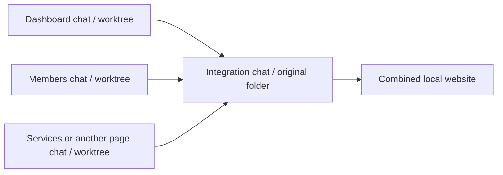

# Working on LifeCity pages in parallel

Use one chat per page and this original project folder for combining finished changes. No ticket system or GitHub pull requests are required. Describe the changes you want; Codex handles the Git operations and reports the result for review.

## The three Git terms you need

- **Commit:** a saved checkpoint of files. A local commit does not upload or deploy anything.
- **Branch:** a name for a line of saved checkpoints, such as `codex/dashboard-layout`.
- **Worktree:** another working folder of this same repository. It has its own source files, so one page chat can edit without replacing another chat's files.

The worktree supplies file isolation. The branch gives the finished work a name. Integration combines saved changes into the original folder. Changes still need review when two pages use the same CSS or component; Codex handles that review and any Git conflicts.



## Which chat and preview to use

These are proposed names and ports, not a list of chats or servers already created. Start with two page chats and add others when needed.

| Chat purpose | Working folder | Suggested preview port |
| --- | --- | --- |
| Integration: combine and verify completed pages | Original `lifecity-attendance` folder | 5173 |
| Dashboard | Its own worktree | 5174 |
| Members | Its own worktree | 5175 |
| Services | Its own worktree | 5176 |
| Scanner | Its own worktree | 5177 |
| Records | Its own worktree | 5178 |
| Settings | Its own worktree | 5179 |

There is no need to run all seven servers. A server only shows source from the folder it runs in. Your existing server will show combined work after integration; it will not automatically include edits still isolated in another worktree. Codex can start a separate page preview when you want to inspect it early.

## Start the first page chat

If another chat is still editing the original folder, let it finish its current batch first. You can send that chat:

```text
Finish and validate your current changes in this original project folder.
Commit only your own completed work locally and report anything unfinished.
We are moving future parallel page changes into separate worktrees.
Do not push or deploy.
```

1. Open a new chat under this LifeCity project.
2. Select **Worktree** below the composer, keeping execution on **This computer**.
3. Select `main` as the starting branch, after any work you need from the original folder has been committed. New worktrees based on committed `main` do not include unfinished local changes.
4. Paste the prompt below, replacing the page, port, and requested change.
5. Let the agent confirm its worktree and provide the preview address when ready.

```text
Work on the Dashboard page in this chat's isolated worktree.
Read AGENTS.md and docs/parallel-work.md first.
Use preview port 5174 and a codex/ branch for this change.

Requested change:
[Describe the behavior or appearance I want.]

Install dependencies if needed and verify .env.local exists without printing it.
Scope styles to the page and identify necessary shared-file changes.
Implement and validate the change, commit only your own work locally,
and finish with the integration handoff described in AGENTS.md.
```

Repeat in another new worktree chat for Members using port 5175, or another page from the table. Each new task should start from the latest integrated `main`; a finished old worktree does not automatically receive later updates to `main`.

Codex-managed worktrees may start without a named branch (Git calls this a detached HEAD). The page agent can create its own `codex/` branch; you do not need to operate the branch controls yourself.

## When a page is ready

The page agent returns a small handoff identifying the finished branch and commits, changed files, checks, and any running preview. Review the page, then tell the integration chat:

```text
Integrate the completed Dashboard work from [branch or page chat name].
Review its handoff and shared CSS changes, preserve other unfinished work,
combine the completed commits into the original project, and validate the
combined website. Keep the changes local.
```

If you identify a page chat, the integration agent can read it to find its handoff. Alternatively paste the branch and completed commit IDs. Reading another chat is different from directing work there; explicitly say so if you want the integration agent to send instructions to it.

The integration agent reviews and combines one completed change at a time. If two changes overlap, it resolves the conflict and checks that both behaviors still work. If a design choice is ambiguous, it explains the concrete choice for you to decide. It does not blindly accept one version of a shared file.

The original folder may contain another chat's unfinished work. The integration agent can review completed branches in the meantime, but must wait to apply commits until the integration checkout is ready. It must not stash, discard, or commit someone else's unfinished edits to clear the way.

You can continue making requests in an existing page chat while another page is in progress. For a fresh independent change after integration, start a new worktree from current `main`, or ask the agent to update its existing worktree first. Keep finished branches/worktrees until integration has been checked.

## What keeps CSS from overlapping

This project imports global stylesheets, including `src/styles.css`, several mobile sheets, and page sheets. File separation alone does not stop a selector such as `.primary-button` from affecting several pages.

- Prefer an existing page container or a new page-specific root class, then scope the selectors underneath it.
- Let page agents change shared code when required, but have them call it out in the handoff.
- Review global selectors, theme variables, media queries, and CSS import order during integration.
- Inspect both the changed page and other pages that use the modified shared styles or components.

These practices reduce overlap. They do not remove the need to check the combined website.

## Preparing a preview

Run these inside the page's own worktree (the page agent can do this):

```powershell
npm ci
npm run dev -- --port 5174 --strictPort
```

Use that page's assigned port. `--strictPort` makes a busy port visible instead of silently starting on another port. Keep the server's printed address as the source of truth.

The root `.worktreeinclude` requests a private copy of the existing ignored `.env.local` in newly created local Codex-managed worktrees. It does not put environment values in Git. Worktrees created manually with Git do not automatically use this file; their agent must arrange the local environment separately. Do not copy `node_modules`; install dependencies in the new folder.

The frontend reads `VITE_SUPABASE_URL` and `VITE_SUPABASE_PUBLISHABLE_KEY`. The current `.env.example` uses an older key name, so preserve the working local settings rather than replacing them from that example.

All previews configured for the same Supabase project share its database and authentication. A worktree does not create a test database. If Google sign-in fails only on a new preview port, its callback address may need to be permitted in the Supabase redirect configuration. Test camera behavior on localhost/HTTPS and the actual device as needed.

For automatic dependency installation in future worktrees, optionally configure a Codex **local environment** setup command of `npm ci` through the app settings. This repository does not change your app settings automatically.

## For the agent combining changes

Record the current integration status and review the exact source commits before applying them. On a clean integration checkout, cherry-pick only the finished page commits in order. Keep `main` checked out in the original folder; do not try to check out a page branch already checked out in another worktree. Resolve conflicts based on the requested behaviors, then run `npm run build` and relevant existing checks and inspect shared visual behavior.

Do not push, deploy, rewrite history, or remove unfinished worktrees as part of routine local integration. No polling or automatic chat-to-chat messaging is configured by this guide.

## Reference

- [Official Codex worktree instructions](https://learn.chatgpt.com/docs/environments/git-worktrees)
- [Official local environment setup instructions](https://learn.chatgpt.com/docs/environments/local-environment)
